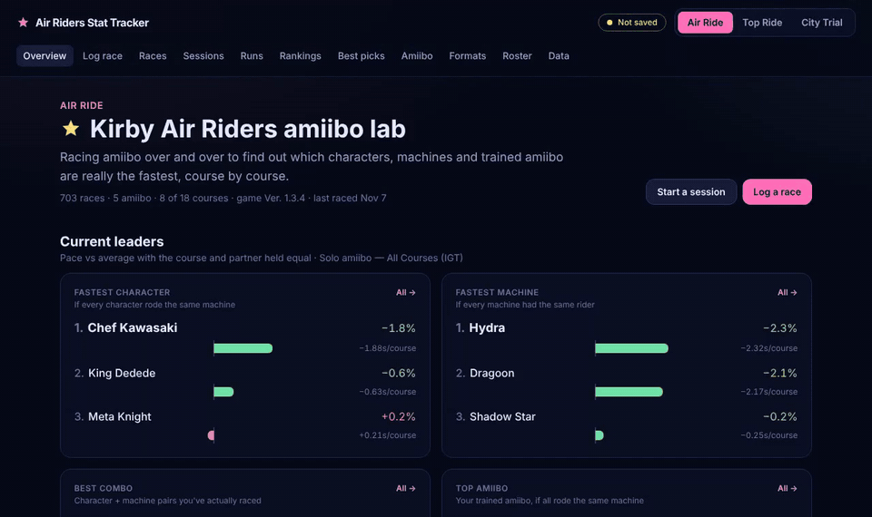
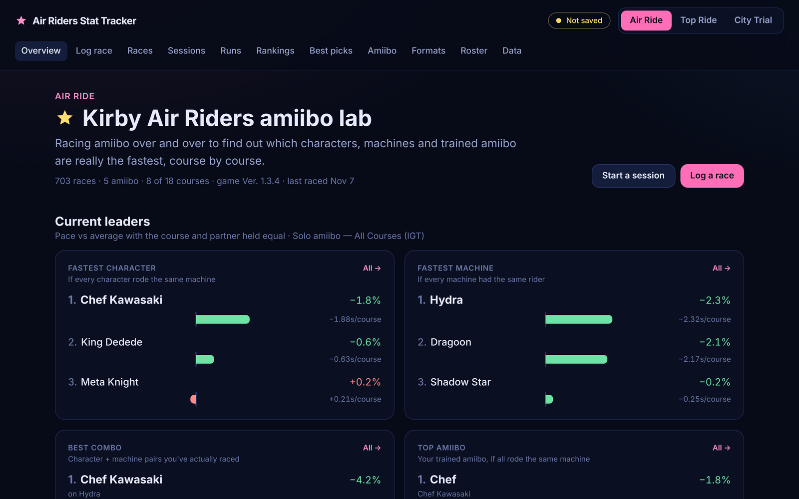
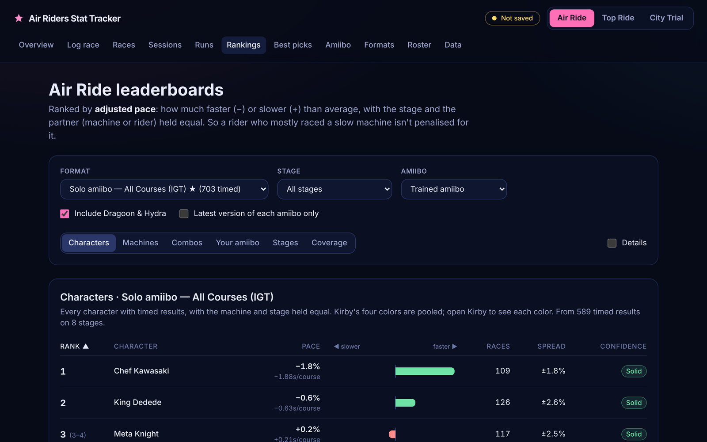
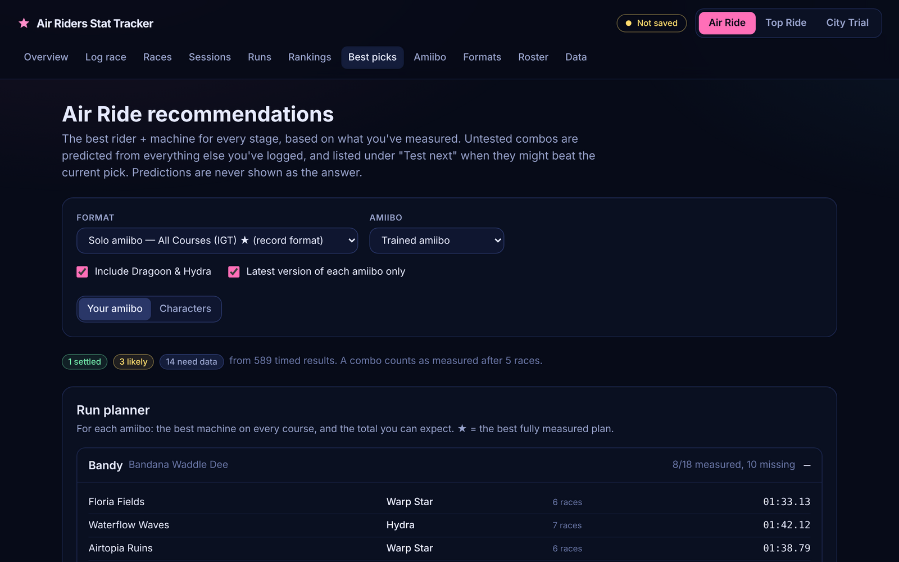
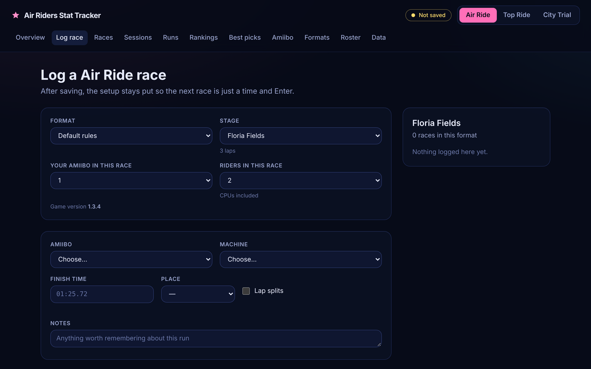
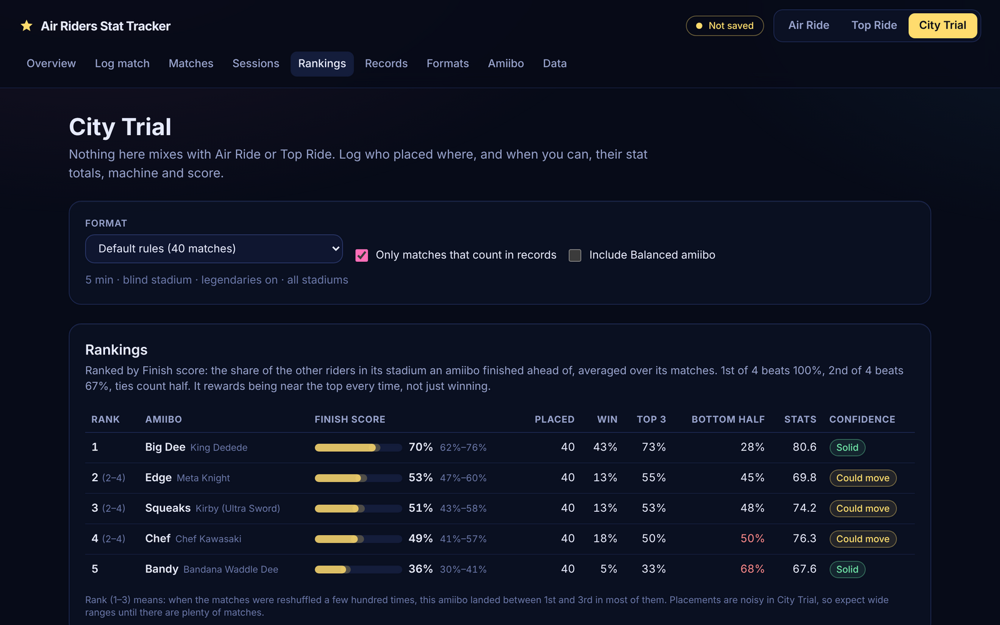
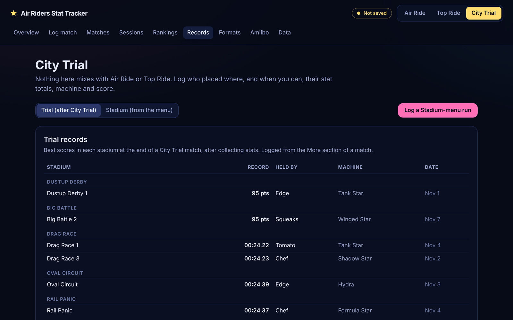

<div align="center">


# Air Riders Stat Tracker

**Find out which characters, machines and trained amiibo are *really* the fastest in Kirby Air Riders, with stats that tell you how sure they are.**

[](https://github.com/Bing-Bong-Bang/air-riders-amiibo-tracker/releases/latest)
[](https://github.com/Bing-Bong-Bang/air-riders-amiibo-tracker/actions/workflows/ci.yml)
[](https://github.com/Bing-Bong-Bang/air-riders-amiibo-tracker/releases)
[](LICENSE)
<br>


[**Download**](#download) · [**Features**](#features) · [**Screenshots**](#screenshots) · [**User guide**](docs/USER_GUIDE.md) · [**Build from source**](#build-from-source)

<br>



<sub>23-second tour with demo data · <a href="docs/demo.mp4">watch as video (MP4)</a></sub>

</div>

---

## Why

Amiibo race themselves, so nobody's thumbs get in the way: the differences you see come from the setup and from the game's own randomness. That makes amiibo racing a surprisingly good lab, **if** the numbers are handled honestly. A few races can make a lucky setup look like the fastest one. This app is built around avoiding exactly that:

- **One variable at a time.** Rankings compare characters on the same machine and course, and machines with the same rider, so nothing gets credit for an easy schedule.
- **Never mix conditions.** Air Ride, Top Ride and City Trial are separate worlds, and so is every ruleset (format). A 4-racer item race never pollutes your solo time-trial numbers.
- **Honest about uncertainty.** Every "X is faster" comes with a likely range, a rank bracket like *(1–3)* and a confidence badge, worked out by re-running the analysis a few hundred times on reshuffled versions of your data.
- **Plain English.** "Tank Star is likely 0.4–2.1 s faster" instead of p-values.

It's built for two jobs: **optimizing a solo world-record speedrun** and **building a knowledge library** of how every character, machine and amiibo behaves.

## Download

Grab the latest version from the **[Releases page](https://github.com/Bing-Bong-Bang/air-riders-amiibo-tracker/releases/latest)**:

| Your computer | File | |
|---|---|---|
| Windows | `…-setup.exe` | installer, adds a Start menu entry |
| Windows (no install) | `…-portable.exe` | runs from anywhere, even a USB stick |
| Mac with Apple Silicon (M1 and later) | `…-mac-arm64.dmg` | |
| Mac with Intel | `…-mac-x64.dmg` | |
| Linux | `…AppImage` or `….deb` | |
| **Anything with a browser** | `….html` | no install: double-click to open in Chrome or Edge |

> [!NOTE]
> The apps aren't code-signed (that costs money), so your computer may warn you the first time.
> **Windows:** "Windows protected your PC" → *More info* → *Run anyway*.
> **macOS:** right-click the app → *Open* → *Open*.

Everything stays on your computer. There's no account, no server and no tracking. Your data lives in the app and, if you choose one, in a save file it keeps up to date automatically.

## Features

### 🏁 Air Ride and Top Ride
- **Fast logging.** Pick course, amiibo and machine, type `1:25.72`, press Enter. The setup stays for the next race.
- **Rankings** for characters, machines, combos, your individual amiibo and courses, by *adjusted pace* (course and partner held equal), with likely ranges, rank brackets and confidence.
- **Best picks:** the best combo for every course (settled / likely / needs data), a full-run planner, and a *test next* list of the races most likely to change a pick.
- **Sessions:** group a night of testing; get that batch's own stats, and compare any number of setups side by side with plain-English conclusions ("wins about 7 races in 10").
- **Runs, PBs and Sum of Best** for full-run speedrun formats.
- **Records, course pages, machine pages and amiibo stat pages**, with notes and a *Copy summary* button for Discord.
- **Baseline (Balanced) amiibo** as a control group, to measure what training actually buys.
- **Game-version stamping**, so a balance patch never quietly mixes old and new results.

### 🏙️ City Trial
- **Quick match logging:** stadium, who played, places (ties work). Stat totals, all 9 stats, end machine, scanned-in figure, KOs and stadium scores are optional, as are field events and field changes.
- **Fill places from scores:** times, points, distance or boss damage turn straight into places.
- **Rankings by Finish score**, the share of the field an amiibo usually beats, plus win, top-3 and bottom-half rates.
- **"Do stats win matches?"**: how often the top stat collector actually wins, upsets, and each amiibo's conversion rate.
- **Two record books** like the game's own: *Trial* (after a City Trial) and *Stadium* (from the Stadium menu, split by rider count).
- **Tournament sets:** points tables, stadium-type bans, top-N advance and tiebreakers.

### 💾 Your data
- **Auto-save to a file** you choose, plus one-click JSON backup and restore.
- **Every import fully checked** before anything changes; restores are all-or-nothing.
- **Per-result "Counts in records" switch** and notes on everything.

## Screenshots

<table>
  <tr>
    <td width="50%"><br><sub><b>Overview:</b> current leaders, records and what the data has shown so far</sub></td>
    <td width="50%"><br><sub><b>Rankings:</b> adjusted pace with rank brackets and confidence</sub></td>
  </tr>
  <tr>
    <td><br><sub><b>Best picks:</b> the best setup per course and what to test next</sub></td>
    <td><br><sub><b>Log race:</b> type a time, press Enter, repeat</sub></td>
  </tr>
  <tr>
    <td><br><sub><b>City Trial rankings:</b> Finish score, likely range and result shape</sub></td>
    <td><br><sub><b>City Trial records:</b> Trial and Stadium-menu books, kept apart</sub></td>
  </tr>
</table>

<sub>Screenshots use made-up demo amiibo.</sub>

## Build from source

You need **[Node.js](https://nodejs.org) 20.19 or newer** (22 LTS recommended).

```bash
git clone https://github.com/Bing-Bong-Bang/air-riders-amiibo-tracker.git
cd air-riders-amiibo-tracker
npm install
npm run dev          # opens a dev server at http://localhost:5173
```

| Command | What it does |
|---|---|
| `npm run dev` | Development server with hot reload |
| `npm run typecheck` | Type-checks everything |
| `npm run build` | Type-checks, then builds the web app into `dist/` |
| `npm run build:single` | Builds the one-file `dist-single/Air Riders Tracker.html` |
| `npm run app` | Builds, then opens the desktop app (Electron) |
| `npm run dist` | Builds installers for your current OS into `release/` |

### Releasing

Bump `version` in `package.json`, add a section to [`CHANGELOG.md`](CHANGELOG.md), then either tag it:

```bash
git tag v0.2.0
git push origin v0.2.0
```

or push to the `release` branch (`git push origin main:release`), and the workflow makes the tag from `package.json`. The [Release workflow](.github/workflows/release.yml) builds Windows, macOS and Linux apps plus the single-file HTML on GitHub's machines and publishes them as a GitHub Release. Pushing to `release-test` runs the same builds without publishing.

### How it's built

- **React 19 + TypeScript + Tailwind CSS 4**, bundled by **Vite**.
- **IndexedDB** for storage, the **File System Access API** for the auto-save file, **Zod** to validate every record.
- **Electron** wraps the same single-file build for the desktop apps; the window is sandboxed, with no Node access.
- No backend, no network calls.

See [CONTRIBUTING.md](CONTRIBUTING.md) for the code layout and the rules the code enforces.

## Contributing

Issues and pull requests are welcome: bug reports, missing game data (stadiums, field events, rule settings), or ideas for better stats. Please read [CONTRIBUTING.md](CONTRIBUTING.md) first.

## Disclaimer

This is an unofficial fan project, not affiliated with or endorsed by Nintendo or HAL Laboratory. *Kirby*, *Kirby Air Riders* and *amiibo* are trademarks of Nintendo.

## License

[MIT](LICENSE)
